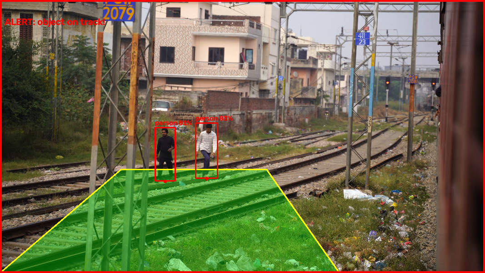

# RailPerception Lite

A lightweight C++ computer-vision prototype that watches railway-track video, marks a **hazard zone** on the track, and raises an **ALERT** when a person or animal is detected inside that zone.

Built with C++ and OpenCV (including the `dnn` module) and YOLOv8n (ONNX), as a 4-week MVP for the FETONIX internship.

## Demo



## Pipeline

1. **Read video** and resize each frame (600 px height).
2. **Classical vision**: grayscale, Gaussian blur, Canny edges.
3. **ROI mask**: keep only the region where rails usually appear.
4. **Probabilistic Hough transform** finds line segments, near-horizontal ones (sleepers) are dropped, the rest are split into left and right rail by median x and fitted with a least-squares line.
5. **Hazard zone**: a perspective corridor (wide at the bottom, narrow at the top) is built around the track centre line, with temporal smoothing to reduce jitter.
6. **YOLOv8n detection** (ONNX via OpenCV `dnn`), run every 3rd frame for speed. Classes kept: person, bicycle, car, motorcycle, cat, dog, horse, sheep, cow.
7. **Alert logic**: the bottom-centre of each bounding box (where the object touches the ground) is tested against the hazard zone. Inside the zone gives a red box, a red frame border and an `ALERT` message.
8. **Recording**: the annotated output is saved to `demo_output.mp4`.

## Project structure

```
RailPerceptionLite/
  CMakeLists.txt
  src/main.cpp
  data/         test videos (not committed)
  models/       yolov8n.onnx (not committed)
```

## Requirements

- MSYS2 MINGW64 with gcc, cmake, git
- OpenCV with the `dnn` module (tested with the MSYS2 OpenCV package)
- `models/yolov8n.onnx`

### Getting the model

Export YOLOv8n to ONNX (for example in Google Colab):

```python
!pip install -q ultralytics
from ultralytics import YOLO
YOLO("yolov8n.pt").export(format="onnx", imgsz=640, opset=12)
```

Download `yolov8n.onnx` and place it in `models/`.

## Build

```bash
mkdir -p build
cd build
cmake ..
cmake --build .
```

## Run

Run from inside the `build` folder (paths are relative to it).

```bash
# Auto mode: hazard zone follows rails found by Hough lines
./rail_perception.exe ../data/test.mp4

# Wide mode: fixed hazard zone, for videos where the auto zone does not fit
./rail_perception.exe ../data/test2.mp4 wide
```

### Keys

| Key | Action |
|-----|--------|
| `p` | pause, press any key to resume |
| `t` | toggle test mode (a fake person is placed inside the zone to verify the alert) |
| `q` / `Esc` | quit |

### Tuning

Constants at the top of `src/main.cpp`:

- `X_SHIFT`, `HALF_W_BOTTOM`, `HALF_W_TOP`: auto-mode corridor position and width
- `WZ_*`: fixed zone corners for wide mode
- `CONF_THRESH`, `NMS_THRESH`, `DETECT_EVERY`: detection settings

## Limitations

- The auto ROI is hand-tuned for one side-angle (train-door) video. Other camera angles need a different ROI or wide mode.
- Wide mode uses a fixed zone, so people standing beside the track can also trigger alerts.
- Rails are close together in the side-angle view, so left/right separation is approximate.
- YOLOv8n is small and fast but less accurate, and confidence is often 40 to 90 percent.
- Not safety-certified, this is a research prototype only.

## Next steps

- Dynamic ROI based on a vanishing point
- Front-facing (driver-view) footage for more reliable rail detection
- Object tracking across frames to reduce flicker
- Distance estimation and graded alerts

## Author

Rumana, BE ECE, Hindusthan College of Engineering & Technology. GitHub: [rumana-alt](https://github.com/rumana-alt)
